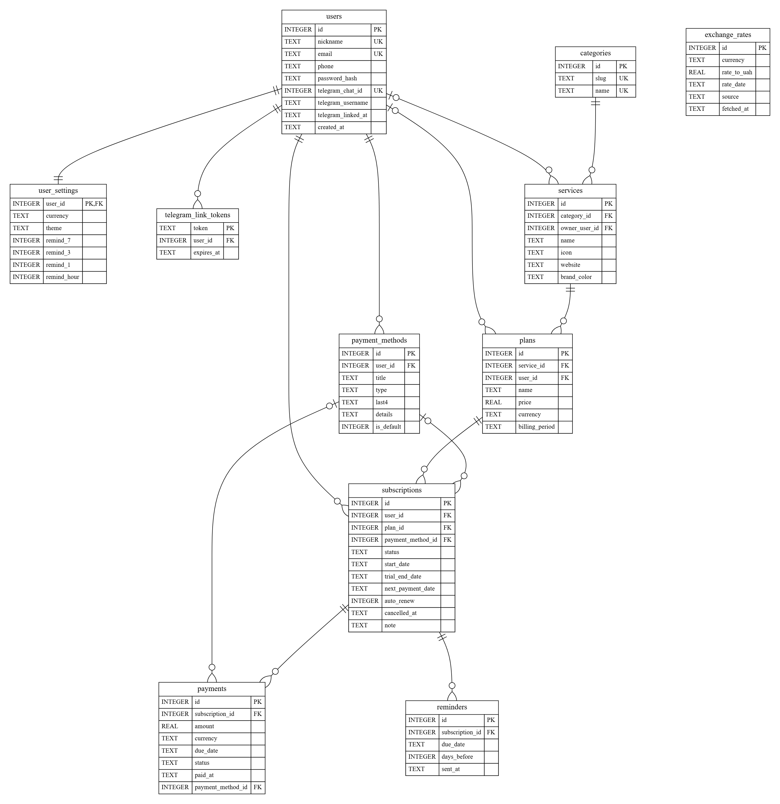

<div align="center">

# Subnetic

              


[English](#english) · [Українська](#українська)

</div>

---

<a id="english"></a>

## 🇬🇧 English

### Contents

- [About](#about)
- [Features](#features)
- [Project structure](#project-structure)
- [Getting started](#getting-started)
- [Configuration](#configuration)
- [Database](#database)
- [npm scripts](#npm-scripts)

### About

Subnetic is a full-stack web application for managing personal subscriptions (streaming, music, cloud, games, AI tools and more). It shows what you pay for, when the next charge is due, how much you spend per month and per year, and sends payment reminders to Telegram.

The project consists of three parts that share one SQLite database:

| Part | Technology | Purpose |
| --- | --- | --- |
| `client/` | React 19, TypeScript, Vite, Tailwind CSS | Web interface (Ukrainian UI, light and dark themes) |
| `server/` | Node.js, Express 5, better-sqlite3 | REST API, business logic, NBU exchange rates |
| `bot/` | Python, aiogram 3, APScheduler | Telegram bot: account linking and reminders |

### Features

#### 🔐 Authentication
- Sign up with nickname, email, optional phone and password; sign in with **email or nickname**.
- Session is a **JWT in an httpOnly cookie**; «Remember me» extends it to 30 days, otherwise it lasts until the browser is closed.
- Passwords are stored as **SHA-256 hashes** (a deliberate simplification for a course project — use bcrypt/argon2 in production).
- Validation with **shared zod schemas** on both client and server; errors come in one format: `{ error, fields }`.
- Protected routes; «Forgot password» page (stub).

#### 📊 Dashboard
- Number of active, trial and paused subscriptions.
- **Monthly spending** and **yearly forecast** in your currency (week × 52 / 12, quarter ÷ 3, year ÷ 12).
- The **nearest payment** with a countdown.
- **Spending chart** for 12 months: actual payments, the current month and a forecast.
- Upcoming subscriptions list.

#### 📋 Subscriptions
- Catalog of **25 services** in 7 categories (streaming, cloud, games, education, music, AI, other) with real logos and **53 plans**, including student plans.
- Custom services and plans when something is missing from the catalog.
- Search, category and status filters, sorting by date, name or price.
- Statuses: trial, active, paused, cancelled, expired; trial periods and auto-renewal.
- Edit, pause, resume, cancel or delete a subscription.

#### 📅 Calendar & payments
- Monthly calendar of paid and expected payments. **Future payments are not stored** — they are calculated from the next payment date and the billing period.
- «Mark as paid» records a payment; a database trigger moves the next payment date forward.
- Payment history with filters (dates, status, subscription, search) and totals.

#### ⚙️ Settings
- Profile (nickname, email, phone), display currency (UAH / USD / EUR) and theme.
- **Current NBU exchange rates** with the rate date and update time.
- Reminders: 7 / 3 / 1 days before a payment and the hour to send them.
- Payment methods (cards, PayPal, Apple Pay, Google Pay), one default method.
- **Telegram**: link / unlink the account, send a test message, **send a reminder about the nearest payment right now**.

#### 💱 Exchange rates (NBU)
- The server downloads USD and EUR rates from the National Bank of Ukraine API on start and **every day at 00:05 (Kyiv time)** with `node-cron`.
- If the NBU is unavailable, the last saved rate is used and the server keeps working.

#### 🤖 Telegram bot
- `/start <token>` — links the chat to an account using a one-time link from Settings (valid for 15 minutes).
- `/account` — account details, reminder settings, the list of subscriptions and the monthly total.
- `/help` — help; for a linked chat it also shows the nearest payment.
- **Reminders** every hour at minute 0: subscriptions due in 7, 3 or 1 day at the user's chosen hour. Each reminder is sent **only once** thanks to a `UNIQUE` constraint in the `reminders` table.

#### 🛠 Server API

All routes except `/api/health` and `/api/auth/*` require a session.

| Route | Description |
| --- | --- |
| `POST /api/auth/register`, `login`, `logout`, `GET /api/auth/me` | Authentication |
| `GET /api/dashboard` | Dashboard data |
| `GET, POST /api/subscriptions`, `PATCH, DELETE /api/subscriptions/:id`, `POST /api/subscriptions/:id/pay` | Subscriptions |
| `GET /api/catalog`, `POST /api/catalog/services`, `POST /api/catalog/plans` | Catalog and custom services/plans |
| `GET /api/payments/calendar?month=YYYY-MM`, `GET /api/payments` | Calendar and payment history |
| `GET, POST /api/payment-methods`, `PATCH, DELETE /api/payment-methods/:id` | Payment methods |
| `GET, PATCH /api/settings`, `PATCH /api/profile` | Settings and profile |
| `GET /api/rates` | Current exchange rates |
| `POST /api/telegram/link`, `unlink`, `test`, `remind-now` | Telegram |
| `GET /api/health` | Health check |

### Project structure

```
Subnetic/
├── client/                    # Web app (React + Vite)
│   ├── public/icons/          # Service logos
│   └── src/
│       ├── api/               # HTTP client and API endpoints
│       ├── components/        # UI kit (ui/) and feature components
│       ├── hooks/             # Data hooks and contexts (auth, settings, theme)
│       ├── lib/               # Types (zod), formatting, Tailwind class sets
│       └── pages/             # Dashboard, Subscriptions, Calendar, Settings, auth pages
├── server/                    # REST API (Express)
│   ├── db/
│   │   ├── schema.sql         # Tables, views, triggers, indexes
│   │   └── seed.sql           # Catalog and fallback exchange rates
│   ├── data/                  # subnetic.db (created automatically, not in git)
│   └── src/
│       ├── auth/              # JWT session and requireAuth middleware
│       ├── db/                # SQL access layer (better-sqlite3)
│       ├── routes/            # HTTP routes
│       ├── services/          # Business logic (subscriptions, schedule, rates, Telegram…)
│       └── index.ts           # Entry point
├── shared/                    # Code shared by client and server
│   ├── auth.ts                # Auth schemas
│   ├── domain.ts              # Request schemas
│   ├── money.ts               # Currencies, conversion, monthly normalization
│   └── dates.ts               # Date helpers
├── bot/                       # Telegram bot (Python)
│   ├── main.py                # Bot, dispatcher, scheduler, polling
│   ├── handlers.py            # /start, /account, /help
│   ├── reminders.py           # Reminder logic and messages
│   ├── db.py                  # SQLite access (sqlite3)
│   ├── config.py              # .env loading
│   ├── start-bot.bat / .sh    # One-click launchers
│   └── requirements.txt
├── docs/                      # ER diagram (PNG, SVG)
├── start-all.bat              # Starts server + client (Windows)
├── start-server.bat
├── start-client.bat
└── package.json               # npm workspaces: client, server
```

### Getting started

**Requirements:** Node.js 22+ (developed on 24), npm, and Python 3.11+ for the Telegram bot (optional).

```bash
git clone https://github.com/ValentinKxD/Subnetic.git
cd Subnetic
npm install
npm run seed     # creates server/data/subnetic.db with the catalog
npm run dev      # server on http://localhost:3001, web app on http://localhost:5173
```

Open **http://localhost:5173**, create an account and add your subscriptions.

On Windows you can also double-click `start-all.bat` (server and client in separate windows) or `start-server.bat` / `start-client.bat`.

#### Telegram bot (optional)

1. Create a bot with [@BotFather](https://t.me/BotFather) (`/newbot`) and copy the token.
2. Fill in `server/.env` and `bot/.env` (see [Configuration](#configuration)) and restart the server.
3. Start the bot:
   - Windows: double-click `bot/start-bot.bat` — it creates a virtual environment, installs dependencies and starts the bot;
   - macOS / Linux: `./bot/start-bot.sh`;
   - manually:
     ```bash
     cd bot
     python -m venv venv
     venv\Scripts\activate        # macOS / Linux: source venv/bin/activate
     pip install -r requirements.txt
     python main.py
     ```
4. In the web app open **Settings → Telegram notifications → Link** and press **Start** in Telegram.

The bot is not part of `npm run dev`, so the project runs without Python.

<a id="configuration"></a>

### Configuration

Environment variables are read from `.env` files. Both files are in `.gitignore`; never commit real tokens.

**`server/.env`**

| Variable | Required | Description |
| --- | --- | --- |
| `JWT_SECRET` | recommended | Secret key that signs session tokens. Without it a built-in development key is used. Generate one: `node -e "console.log(require('crypto').randomBytes(48).toString('base64url'))"` |
| `TELEGRAM_BOT_TOKEN` | for Telegram | Bot token from @BotFather (used for test messages and «send reminder now») |
| `TELEGRAM_BOT_NAME` | for Telegram | Bot username without `@` (used in the linking link `t.me/<name>?start=<token>`) |
| `PORT` | no | API port, `3001` by default |
| `SUBNETIC_DB` | no | Path to the database file, `server/data/subnetic.db` by default |
| `NBU_URL` | no | NBU rates API URL (override for testing) |

**`bot/.env`** (template: `bot/.env.example`)

| Variable | Required | Description |
| --- | --- | --- |
| `TELEGRAM_BOT_TOKEN` | yes | The same token as on the server |
| `DB_PATH` | no | Path to the database, `../server/data/subnetic.db` by default |
| `TZ` | no | Time zone for reminders, `Europe/Kyiv` by default |

Without Telegram variables the server works normally and Settings show «bot is not configured». The server reads `.env` only on start — restart it after changes.

### Database

SQLite file `server/data/subnetic.db`. The server creates it from `server/db/schema.sql` on first start; `npm run seed` recreates it and fills in the catalog and fallback exchange rates (**this deletes all users**). The server and the bot use the same file in **WAL mode** with `busy_timeout`, so they do not block each other.

[](docs/er-diagram.svg)

*Click the image to open the vector (SVG) version.*

**Legend:** `PK` — primary key, `FK` — foreign key, `UK` — unique. Crow's foot notation: two bars — exactly one, circle + bar — zero or one, circle + crow's foot — zero or many. `exchange_rates` has no foreign keys: rates are matched by currency code.

| Table | Contents |
| --- | --- |
| `users` | Accounts: nickname, email, phone, password hash, linked Telegram chat |
| `user_settings` | Currency, theme, reminder switches and hour |
| `telegram_link_tokens` | One-time account linking tokens (15 min) |
| `categories`, `services`, `plans` | Catalog; services and plans can also be user-defined |
| `payment_methods` | User payment methods, one default |
| `subscriptions` | Subscriptions: plan, status, start, trial end, next payment date, auto-renewal |
| `payments` | Payment history (paid / failed / refunded) |
| `reminders` | Sent reminders; `UNIQUE(subscription_id, due_date, days_before)` prevents duplicates |
| `exchange_rates` | Rate history to UAH by date (NBU or fallback) |

**Views:** `v_current_rates` (latest rate per currency), `v_subscription_details`, `v_subscription_monthly_cost` (monthly cost in UAH), `v_upcoming_payments`.

**Triggers:** after a successful payment the next payment date moves forward by the plan period and a trial becomes active; cancelling a subscription sets `cancelled_at`.

Constraints (`CHECK`, `UNIQUE`, foreign keys) keep the data valid: date formats, positive prices, allowed currencies and statuses, no `@` in nicknames.

### npm scripts

| Command | What it does |
| --- | --- |
| `npm run dev` | Server and web app in watch mode |
| `npm run seed` | Recreate the database with the catalog and rates |
| `npm run build` | Build the server and the web app |
| `npm run typecheck` | TypeScript checks for the server and the web app |
| `npm run bot` | Start the Telegram bot (activate the bot's virtual environment first) |

---

<a id="українська"></a>

## 🇺🇦 Українська

### Зміст

- [Про проєкт](#про-проєкт)
- [Можливості](#можливості)
- [Структура папок](#структура-папок)
- [Як запустити](#як-запустити)
- [Налаштування](#config-ua)
- [База даних](#база-даних)
- [npm-скрипти](#npm-скрипти)

### Про проєкт

Subnetic — вебзастосунок для обліку особистих підписок (стримінг, музика, хмара, ігри, ШІ-сервіси тощо). Він показує, за що ви платите, коли наступне списання, скільки виходить на місяць і на рік, і надсилає нагадування про платежі в Telegram.

Проєкт складається з трьох частин, які працюють з однією базою SQLite:

| Частина | Технології | Призначення |
| --- | --- | --- |
| `client/` | React 19, TypeScript, Vite, Tailwind CSS | Вебінтерфейс (українською, світла й темна теми) |
| `server/` | Node.js, Express 5, better-sqlite3 | REST API, бізнес-логіка, курси НБУ |
| `bot/` | Python, aiogram 3, APScheduler | Telegram-бот: прив'язка акаунта й нагадування |

### Можливості

#### 🔐 Автентифікація
- Реєстрація з нікнеймом, email, необов'язковим телефоном і паролем; вхід **за email або нікнеймом**.
- Сесія — **JWT у httpOnly-куці**; «Запам'ятати мене» продовжує її до 30 днів, інакше вона діє до закриття браузера.
- Паролі зберігаються як **SHA-256-хеші** (свідоме спрощення для курсової — у реальному застосунку bcrypt/argon2).
- Валідація **спільними zod-схемами** на клієнті й сервері; помилки в єдиному форматі `{ error, fields }`.
- Захищені маршрути; сторінка «Забули пароль» (заглушка).

#### 📊 Дашборд
- Кількість активних, пробних і призупинених підписок.
- **Витрати за місяць** і **річний прогноз** у вашій валюті (тиждень × 52 / 12, квартал ÷ 3, рік ÷ 12).
- **Найближчий платіж** із відліком днів.
- **Графік витрат** за 12 місяців: фактичні платежі, поточний місяць і прогноз.
- Список найближчих підписок.

#### 📋 Підписки
- Каталог із **25 сервісів** у 7 категоріях (стримінг, хмара, ігри, навчання, музика, ШІ, інше) зі справжніми логотипами та **53 тарифи**, зокрема студентські.
- Власні сервіси й тарифи, якщо чогось немає в каталозі.
- Пошук, фільтри за категорією й статусом, сортування за датою, назвою чи ціною.
- Статуси: пробна, активна, на паузі, скасована, завершена; пробний період і автопродовження.
- Редагування, пауза, відновлення, скасування й видалення підписки.

#### 📅 Календар і платежі
- Календар місяця зі сплаченими й очікуваними платежами. **Майбутні платежі не зберігаються** — вони обчислюються з дати наступного платежу й періоду тарифу.
- «Позначити оплаченим» записує платіж, а тригер бази даних зсуває дату наступного платежу.
- Історія платежів із фільтрами (дати, статус, підписка, пошук) і підсумками.

#### ⚙️ Налаштування
- Профіль (нікнейм, email, телефон), валюта відображення (UAH / USD / EUR) і тема.
- **Поточні курси НБУ** з датою курсу й часом оновлення.
- Нагадування: за 7 / 3 / 1 день до платежу та година надсилання.
- Способи оплати (картки, PayPal, Apple Pay, Google Pay), один основний.
- **Telegram**: прив'язати / відв'язати акаунт, надіслати тестове повідомлення, **надіслати нагадування про найближчий платіж прямо зараз**.

#### 💱 Курси валют (НБУ)
- Сервер завантажує курси USD і EUR з API Національного банку України при старті та **щодня о 00:05 за Києвом** (`node-cron`).
- Якщо НБУ недоступний — використовується останній збережений курс, сервер працює далі.

#### 🤖 Telegram-бот
- `/start <токен>` — прив'язує чат до акаунта за одноразовим посиланням із Налаштувань (діє 15 хвилин).
- `/account` — дані акаунта, налаштування нагадувань, список підписок і сума на місяць.
- `/help` — довідка; для прив'язаного чату ще й найближчий платіж.
- **Нагадування** щогодини на початку години: підписки, що списуються через 7, 3 або 1 день, о годині, яку обрав користувач. Кожне нагадування надсилається **лише один раз** завдяки обмеженню `UNIQUE` у таблиці `reminders`.

#### 🛠 API сервера

Усі маршрути, крім `/api/health` і `/api/auth/*`, потребують сесії.

| Маршрут | Опис |
| --- | --- |
| `POST /api/auth/register`, `login`, `logout`, `GET /api/auth/me` | Автентифікація |
| `GET /api/dashboard` | Дані дашборда |
| `GET, POST /api/subscriptions`, `PATCH, DELETE /api/subscriptions/:id`, `POST /api/subscriptions/:id/pay` | Підписки |
| `GET /api/catalog`, `POST /api/catalog/services`, `POST /api/catalog/plans` | Каталог, власні сервіси й тарифи |
| `GET /api/payments/calendar?month=YYYY-MM`, `GET /api/payments` | Календар та історія платежів |
| `GET, POST /api/payment-methods`, `PATCH, DELETE /api/payment-methods/:id` | Способи оплати |
| `GET, PATCH /api/settings`, `PATCH /api/profile` | Налаштування й профіль |
| `GET /api/rates` | Поточні курси валют |
| `POST /api/telegram/link`, `unlink`, `test`, `remind-now` | Telegram |
| `GET /api/health` | Перевірка стану |

### Структура папок

```
Subnetic/
├── client/                    # Вебзастосунок (React + Vite)
│   ├── public/icons/          # Логотипи сервісів
│   └── src/
│       ├── api/               # HTTP-клієнт і запити до API
│       ├── components/        # UI-компоненти (ui/) і компоненти розділів
│       ├── hooks/             # Хуки даних і контексти (авторизація, налаштування, тема)
│       ├── lib/               # Типи (zod), форматування, набори Tailwind-класів
│       └── pages/             # Дашборд, Підписки, Календар, Налаштування, вхід і реєстрація
├── server/                    # REST API (Express)
│   ├── db/
│   │   ├── schema.sql         # Таблиці, подання, тригери, індекси
│   │   └── seed.sql           # Каталог і резервні курси валют
│   ├── data/                  # subnetic.db (створюється автоматично, не в git)
│   └── src/
│       ├── auth/              # JWT-сесія і middleware requireAuth
│       ├── db/                # Шар доступу до SQL (better-sqlite3)
│       ├── routes/            # HTTP-маршрути
│       ├── services/          # Бізнес-логіка (підписки, графік, курси, Telegram…)
│       └── index.ts           # Точка входу
├── shared/                    # Спільний код клієнта й сервера
│   ├── auth.ts                # Схеми автентифікації
│   ├── domain.ts              # Схеми запитів
│   ├── money.ts               # Валюти, конвертація, нормалізація до місяця
│   └── dates.ts               # Робота з датами
├── bot/                       # Telegram-бот (Python)
│   ├── main.py                # Бот, диспетчер, планувальник, polling
│   ├── handlers.py            # /start, /account, /help
│   ├── reminders.py           # Логіка й текст нагадувань
│   ├── db.py                  # Доступ до SQLite (sqlite3)
│   ├── config.py              # Читання .env
│   ├── start-bot.bat / .sh    # Запуск одним кліком
│   └── requirements.txt
├── docs/                      # ER-діаграма (PNG, SVG)
├── start-all.bat              # Запуск сервера й клієнта (Windows)
├── start-server.bat
├── start-client.bat
└── package.json               # npm workspaces: client, server
```

### Як запустити

**Потрібно:** Node.js 22+ (розробка на 24), npm і Python 3.11+ для Telegram-бота (необов'язково).

```bash
git clone https://github.com/ValentinKxD/Subnetic.git
cd Subnetic
npm install
npm run seed     # створює server/data/subnetic.db з каталогом
npm run dev      # сервер на http://localhost:3001, сайт на http://localhost:5173
```

Відкрийте **http://localhost:5173**, зареєструйтеся й додайте свої підписки.

На Windows можна просто двічі клацнути `start-all.bat` (сервер і клієнт в окремих вікнах) або `start-server.bat` / `start-client.bat`.

#### Telegram-бот (необов'язково)

1. Створіть бота в [@BotFather](https://t.me/BotFather) (`/newbot`) і скопіюйте токен.
2. Заповніть `server/.env` і `bot/.env` (див. [Налаштування](#config-ua)) і перезапустіть сервер.
3. Запустіть бота:
   - Windows: двічі клацніть `bot/start-bot.bat` — він створить віртуальне середовище, встановить залежності й запустить бота;
   - macOS / Linux: `./bot/start-bot.sh`;
   - вручну:
     ```bash
     cd bot
     python -m venv venv
     venv\Scripts\activate        # macOS / Linux: source venv/bin/activate
     pip install -r requirements.txt
     python main.py
     ```
4. На сайті відкрийте **Налаштування → Telegram-сповіщення → Привʼязати** і натисніть **Start** у Telegram.

Бот не входить у `npm run dev`, тож проєкт запускається й без Python.

<a id="config-ua"></a>

### Налаштування

Змінні оточення читаються з файлів `.env`. Обидва файли в `.gitignore` — справжні токени не комітьте.

**`server/.env`**

| Змінна | Обов'язкова | Опис |
| --- | --- | --- |
| `JWT_SECRET` | бажано | Секретний ключ підпису сесій. Без нього використовується вбудований dev-ключ. Згенерувати: `node -e "console.log(require('crypto').randomBytes(48).toString('base64url'))"` |
| `TELEGRAM_BOT_TOKEN` | для Telegram | Токен бота від @BotFather (тестове повідомлення й «надіслати нагадування зараз») |
| `TELEGRAM_BOT_NAME` | для Telegram | Ім'я бота без `@` (для посилання прив'язки `t.me/<ім'я>?start=<токен>`) |
| `PORT` | ні | Порт API, за замовчуванням `3001` |
| `SUBNETIC_DB` | ні | Шлях до файлу бази, за замовчуванням `server/data/subnetic.db` |
| `NBU_URL` | ні | Адреса API курсів НБУ (для тестів) |

**`bot/.env`** (шаблон: `bot/.env.example`)

| Змінна | Обов'язкова | Опис |
| --- | --- | --- |
| `TELEGRAM_BOT_TOKEN` | так | Той самий токен, що й на сервері |
| `DB_PATH` | ні | Шлях до бази, за замовчуванням `../server/data/subnetic.db` |
| `TZ` | ні | Часовий пояс нагадувань, за замовчуванням `Europe/Kyiv` |

Без змінних Telegram сервер працює звичайно, а в Налаштуваннях показується «бот не налаштований». Сервер читає `.env` лише при старті — після змін перезапустіть його.

### База даних

Файл SQLite `server/data/subnetic.db`. Сервер створює його зі `server/db/schema.sql` при першому запуску; `npm run seed` перестворює базу й заповнює каталог і резервні курси (**при цьому видаляються всі користувачі**). Сервер і бот працюють з одним файлом у **режимі WAL** із `busy_timeout`, тому не блокують один одного.

[](docs/er-diagram.svg)

*Натисніть на зображення, щоб відкрити векторну версію (SVG).*

**Позначення:** `PK` — первинний ключ, `FK` — зовнішній ключ, `UK` — унікальне значення. Нотація «воронячі лапки»: дві риски — рівно один, коло + риска — нуль або один, коло + «лапка» — нуль або багато. `exchange_rates` не має зовнішніх ключів: курси зіставляються за кодом валюти.

| Таблиця | Що зберігає |
| --- | --- |
| `users` | Акаунти: нікнейм, email, телефон, хеш пароля, прив'язаний Telegram-чат |
| `user_settings` | Валюта, тема, перемикачі й година нагадувань |
| `telegram_link_tokens` | Одноразові токени прив'язки Telegram (15 хв) |
| `categories`, `services`, `plans` | Каталог; сервіси й тарифи можуть бути й власними |
| `payment_methods` | Способи оплати користувача, один основний |
| `subscriptions` | Підписки: тариф, статус, початок, кінець пробного періоду, наступний платіж, автопродовження |
| `payments` | Історія платежів (сплачено / помилка / повернено) |
| `reminders` | Надіслані нагадування; `UNIQUE(subscription_id, due_date, days_before)` не дає дублів |
| `exchange_rates` | Історія курсів до гривні за датами (НБУ або резервні) |

**Подання (VIEW):** `v_current_rates` (актуальний курс кожної валюти), `v_subscription_details`, `v_subscription_monthly_cost` (місячна вартість у гривнях), `v_upcoming_payments`.

**Тригери:** після успішної оплати дата наступного платежу зсувається на період тарифу, а пробна підписка стає активною; при скасуванні ставиться `cancelled_at`.

Обмеження (`CHECK`, `UNIQUE`, зовнішні ключі) тримають дані коректними: формати дат, додатні ціни, допустимі валюти й статуси, заборона `@` у нікнеймі.

### npm-скрипти

| Команда | Що робить |
| --- | --- |
| `npm run dev` | Сервер і сайт у режимі розробки |
| `npm run seed` | Перестворити базу з каталогом і курсами |
| `npm run build` | Зібрати сервер і сайт |
| `npm run typecheck` | Перевірка типів TypeScript сервера й сайту |
| `npm run bot` | Запустити Telegram-бота (спершу активуйте віртуальне середовище бота) |
